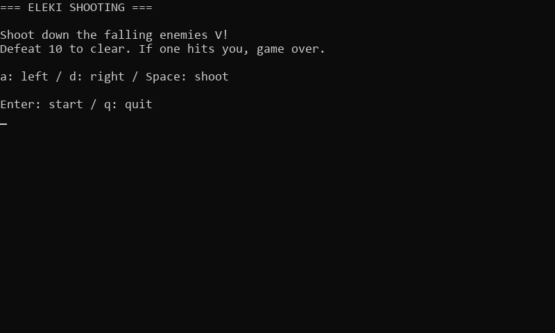

# Eleki Shooting

A real-time shooter where your ship `A` fires lightning bullets `ϟ` to shoot down enemies `V` coming down from the top.<br>
Defeat 10 enemies to clear. If an enemy hits your ship even once, it's game over (enemies that reach the bottom disappear).



## How to run

See the [collection README](../README.md#requirements) for the requirements.<br>
From the root of the repository, run one of the following.

```sh
# Python version
python 06_cli_games/03_eleki_shooting/python/main.py

# JavaScript version
node 06_cli_games/03_eleki_shooting/javascript/main.js
```

Keys are read without pressing Enter, so start it from a normal terminal, not from something like an editor's "Output" panel.

| Key   | Action                                          |
| ----- | ----------------------------------------------- |
| Enter | Start (title screen)                            |
| a / d | Move one cell left / right                      |
| Space | Shoot                                           |
| r     | Back to the title (clear / game over screens)   |
| q     | Quit (title / clear / game over screens)        |

## Mechanisms from the series

| Episode | Mechanism                 | In this game                                                                                                                         |
| ------- | ------------------------- | ------------------------------------------------------------------------------------------------------------------------------------ |
| Ep. 1   | Game loop                 | Repeats input → update → draw. Enemies keep coming down even if you don't press a key                                                |
| Ep. 2   | Delta time                | The speed of enemies and bullets is "cells per second × `delta_time`". Positions are kept as decimals and made integers only to draw |
| Ep. 2   | Counting time             | The enemy spawn timer (`spawn_timer`) goes down by `delta_time`, and an enemy appears when it reaches 0                              |
| Ep. 3   | Input checked every frame | `read_key()` doesn't wait, and returns the pressed key or an empty string                                                            |
| Ep. 4   | Game state                | Changes title → playing → clear / game over with `change_state()`                                                                    |
| Ep. 5   | Random numbers            | Decides the column an enemy appears in with `random.randrange()`                                                                     |

## Implementation

#### Game state

In this game, the "game state" (`game_state`) is kept inside `Game`, the data for the whole game.<br>
As in game 1, the kinds of state are defined as constants.

| Value (constant)        | Screen       |
| ----------------------- | ------------ |
| `GAME_STATE_TITLE`      | Title screen |
| `GAME_STATE_PLAYING`    | Playing      |
| `GAME_STATE_GAME_CLEAR` | Game clear   |
| `GAME_STATE_GAME_OVER`  | Game over    |

The state is always changed through `change_state()`, and the start-up for entering playing, `start_playing()`, resets the ship, enemies, bullets and score.

```text
TITLE ────→ PLAYING ──defeated 10──→ GAME_CLEAR
  ↑             └───hit by enemy───→ GAME_OVER
  └─────────────────────────────────────┘
```

#### Code flow

Read the loop in `main()` in the order input → update → draw.<br>
The loop has the same "loop with a clock" shape as Burger Typing, and the update while playing, `update_playing()`, is split into functions for each "thing": the ship, bullets and enemies.

```python
def update_playing(game, key, delta_time):
    # Update the player, bullets and enemies
    update_player(game, key)
    update_bullets(game, delta_time)
    update_enemies(game, delta_time)

    # Hit detection
    hit_bullets_and_enemies(game)

    # Game state check
    if game.score >= GOAL_SCORE:
        change_state(game, GAME_STATE_GAME_CLEAR)
    elif is_player_hit(game):
        change_state(game, GAME_STATE_GAME_OVER)
```

| Function                    | What it does                                                                                                                       |
| --------------------------- | ---------------------------------------------------------------------------------------------------------------------------------- |
| `update_player()`           | Moves the ship left and right with a / d, and shoots with Space                                                                    |
| `update_bullets()`          | Moves bullets up and removes the ones that left the top of the screen                                                              |
| `update_enemies()`          | When the spawn timer reaches 0, puts an enemy in a random column, moves enemies down, and removes the ones that left the bottom    |
| `hit_bullets_and_enemies()` | Checks hits between bullets and enemies, removes the ones that hit, and adds to the score                                          |
| `is_player_hit()`           | Checks whether an enemy is in the same cell as the ship                                                                            |
| `draw()`                    | Draws the board as a grid of characters for the game state, and redraws it with the heading                                        |

#### Hit detection that doesn't pass through

A fast bullet moves several cells in one frame, so checking "is it in the same cell" can let it pass through an enemy.<br>
This game uses the fact that bullets move up and enemies move down, and checks "same column, and the bullet has passed the enemy (`bullet.y <= enemy.y`)".

Bullets and enemies that hit are not removed from the list on the spot; they are only marked with `is_alive = False`.<br>
Removing items from a list while looping over it would shift the next items to check. The marked bullets and enemies are removed together at the end of `hit_bullets_and_enemies()`.

#### Key input without waiting for Enter

`terminal_input.py` (`terminal_input.js`) is the same as in Burger Typing ([explanation](../02_burger_typing/README.md#key-input-without-waiting-for-enter)).<br>
Arrow keys arrive differently on each OS, so movement uses the letter keys `a` / `d`.
