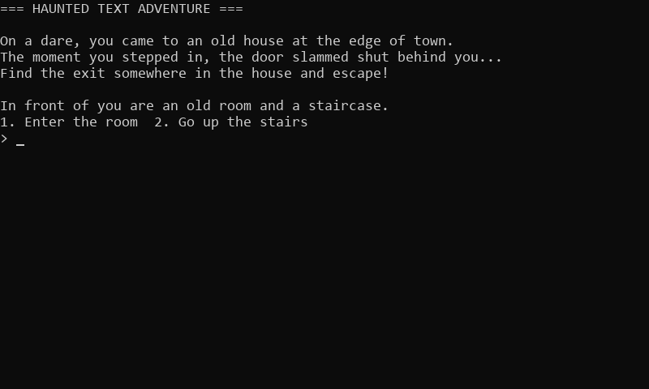
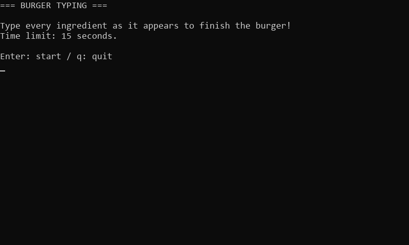

# CLI Game Samples

A collection of small CLI games made in **Ep. 6 "Making CLI Games"** of "How Games Work: Basics".

There are 3 games that combine the mechanisms covered in Ep. 1 to Ep. 5.<br>
Every game has a Python version and a JavaScript (Node.js) version, and both are the same game.

## Games

| #   | Game                                                    | What it is                                                                     | Main mechanisms                                                     |
| --- | ------------------------------------------------------- | ------------------------------------------------------------------------------ | ------------------------------------------------------------------- |
| 1   | [Haunted Text Adventure](01_text_adventure/README.md)   | Pick choices to escape from a haunted house                                    | Game loop, waiting for input, game state                            |
| 2   | [Burger Typing](02_burger_typing/README.md)             | Type ingredients shown in random order to finish a burger within the time limit | FPS and delta time, input that doesn't wait, state changes, random numbers |
| 3   | [Eleki Shooting](03_eleki_shooting/README.md)           | A real-time shooter where you shoot down enemies coming down                   | All of the mechanisms so far                                        |

## Screenshots

These are the games running.<br>
How to play and how each game works are explained in each game's README.

### Haunted Text Adventure

A text adventure where you pick choices to escape from a haunted house.



### Burger Typing

Type 6 ingredients within the time limit to finish the burger.



### Eleki Shooting

Move left and right and shoot to defeat 10 enemies.


## Mechanisms from the series

| Episode | Mechanism                    |  1  |  2  |  3  |
| ------- | ---------------------------- | :-: | :-: | :-: |
| Ep. 1   | Game loop                    |  ○  |  ○  |  ○  |
| Ep. 2   | Frame rate and delta time    |     |  ○  |  ○  |
| Ep. 3   | Input                        |  ○  |  ○  |  ○  |
| Ep. 4   | Game state                   |  ○  |  ○  |  ○  |
| Ep. 5   | Random numbers               |     |  ○  |  ○  |

## Requirements

To run the games, you need one of the following for each item.

- Runtime
  - Python version: Python 3.10 or later
  - JavaScript version: Node.js 18 or later
- Terminal
  - Windows Terminal / PowerShell
  - The standard terminal on macOS or Linux

From the root of the repository, run `main.py` (Python version) or `main.js` (JavaScript version) of the game you want to play.

```sh
# Python version
python 06_cli_games/01_text_adventure/python/main.py
python 06_cli_games/02_burger_typing/python/main.py
python 06_cli_games/03_eleki_shooting/python/main.py

# JavaScript version
node 06_cli_games/01_text_adventure/javascript/main.js
node 06_cli_games/02_burger_typing/javascript/main.js
node 06_cli_games/03_eleki_shooting/javascript/main.js
```

## Folder structure

Each game is self-contained in its own folder.

```text
06_cli_games/
├─ README.md           # this file
├─ code_guide.md       # code style rules
├─ 01_text_adventure/  # Haunted Text Adventure
│  ├─ README.md        # how to play and how it works
│  ├─ images/          # images for the README
│  ├─ python/          # Python version (main.py)
│  └─ javascript/      # JavaScript version (main.js)
├─ 02_burger_typing/   # Burger Typing (same structure)
└─ 03_eleki_shooting/  # Eleki Shooting (same structure)
```

The code style rules are in [code_guide.md](code_guide.md).
