# 3D Game Samples (AI-generated)

Samples for Ep. 7 "Turning Games 3D with AI" of "How Games Work: Basics".<br>
They were made by asking Claude Code, with the prompts below, to turn the [CLI games from Ep. 6](../06_cli_games/README.md) into 3D.<br>
The core of each game is in its main.js.<br>
The models and other visuals differ, but you should find that the overall flow and implementation are surprisingly unchanged.

```
// Prompts that were run (originally written in Japanese; translated here)

// 1st
Make each game under tools\lec-game-cli-example\game into a 3D game you can play, keeping the same rules.
Use Three.js so they can be played in the browser.
Recreate the models as simple models made by combining cubes.

// 2nd
This is hard to play as it is, so make a menu that starts each game.
Also put a Back button in each game screen so you can return to the menu.
```

Note: the path in the prompt (`tools\lec-game-cli-example\game`) is where the games were when this was made. In this repository it corresponds to `06_cli_games/`.

## How to run

The JavaScript of each game is split into separate files (`main.js` / `models.js`), so open the games from a local server (if you open the files directly, the browser's restrictions prevent them from loading).<br>
Run the following command at the root of the repository (`how-games-work-en/`), and open the URL that is shown (such as http://localhost:3000) in the browser to get the menu.

```sh
npm run play-3d
```

Choose a game from the menu (the 1 / 2 / 3 keys also work) to start it, and press "Back" at the top left of the game screen to return to the menu.<br>
Three.js is loaded from a CDN (jsDelivr), so an internet connection is required.

## Games

The 3 games in `06_cli_games/`, made playable in 3D with Three.js while keeping the rules (game states, transitions, constants, key controls and clear conditions) the same.<br>
All models are made by combining cubes (`BoxGeometry`).

| #   | Game                   | Original game                                                                 |
| --- | ---------------------- | ----------------------------------------------------------------------------- |
| 1   | Haunted Text Adventure | [06_cli_games/01_text_adventure](../06_cli_games/01_text_adventure/README.md) |
| 2   | Burger Typing          | [06_cli_games/02_burger_typing](../06_cli_games/02_burger_typing/README.md)   |
| 3   | Eleki Shooting         | [06_cli_games/03_eleki_shooting](../06_cli_games/03_eleki_shooting/README.md) |

## Screenshots

#### Menu

The menu appears when you start, and you can choose the game you want to play.

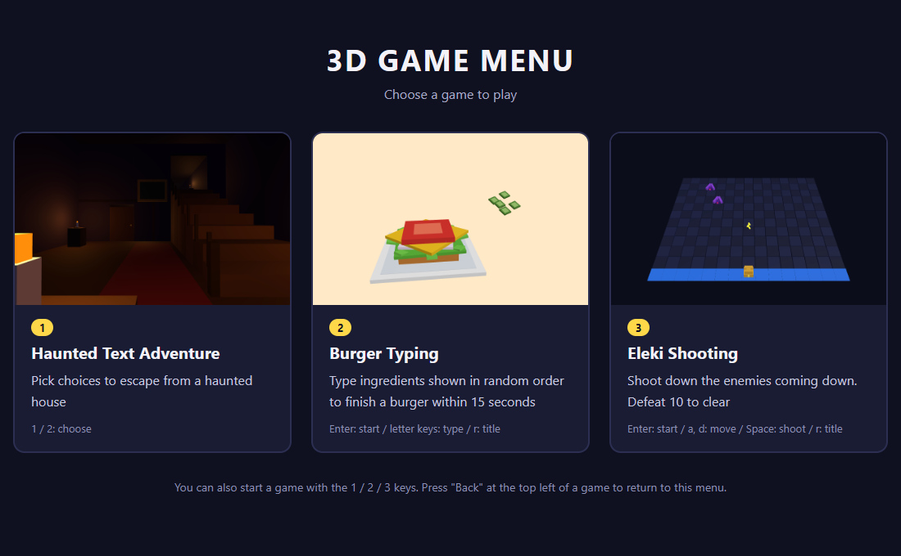

#### Haunted Text Adventure

You move through the mansion in first person. The camera moves with the choice you pick, and the text flows at the bottom of the screen in the same order as the CLI version.


| Entrance hall (HALL)                                         | Corridor (CORRIDOR)                                    | Exit (GAME CLEAR)                                |
| ------------------------------------------------------------ | ------------------------------------------------------ | ------------------------------------------------ |
| 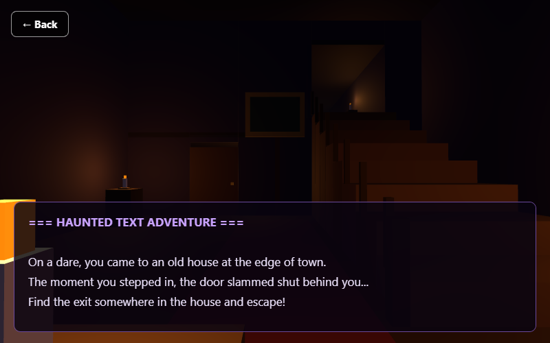    | 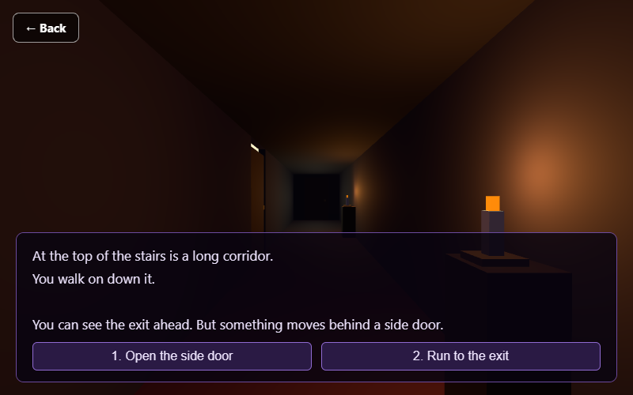 | 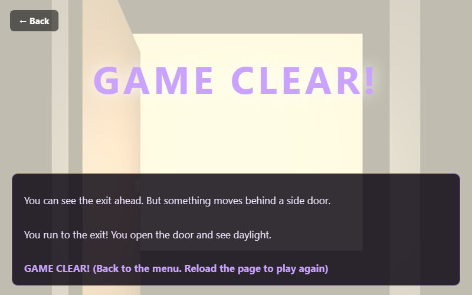 |

If you enter the old room, a ghost jumps out and it's game over.

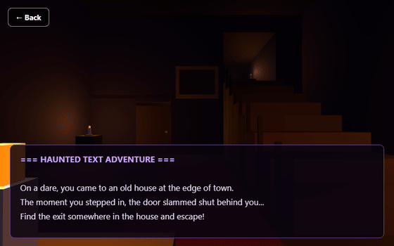

#### Burger Typing

Each time you finish typing an ingredient, it drops onto the plate and stacks up. Type all 6 and the top bun goes on to finish the burger.

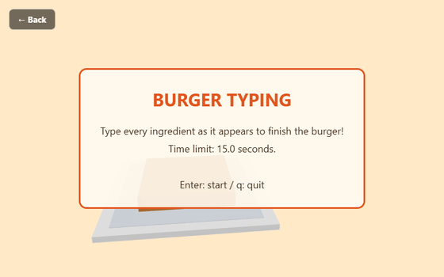

| Title                                            | Playing                                              | Clear                                            |
| ------------------------------------------------ | ---------------------------------------------------- | ------------------------------------------------ |
|  | 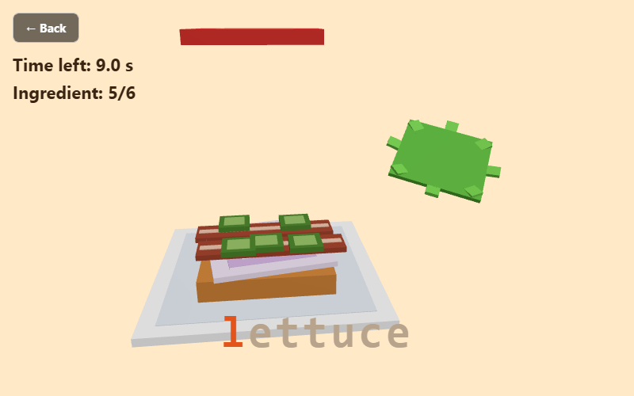 | 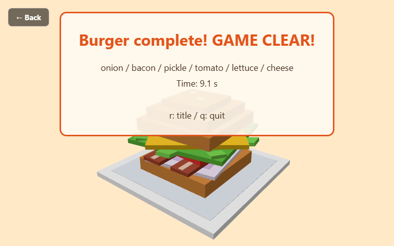 |

#### Eleki Shooting

You look down at the same 15 × 12 board as the CLI version from above at an angle. Defeated enemies burst into pieces.

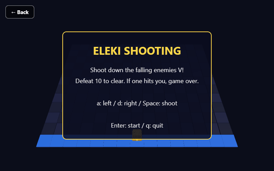

| Title                                             | Playing                                               | Clear                                             |
| ------------------------------------------------- | ----------------------------------------------------- | ------------------------------------------------- |
| 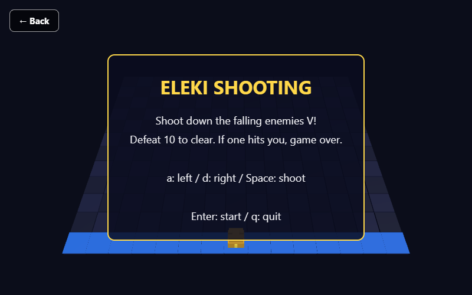 | 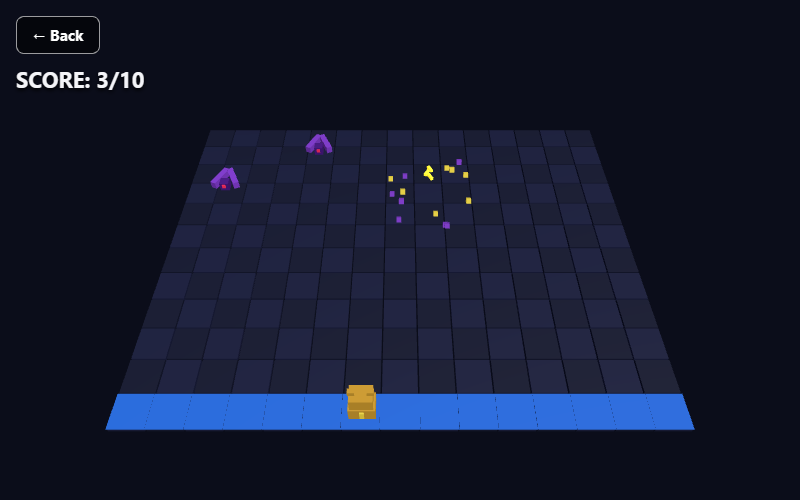 | 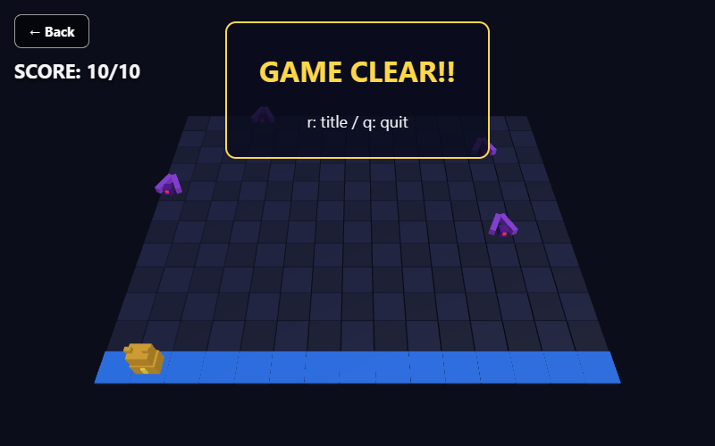 |

## Folder structure

Each game is split into 3 files: "screen (HTML)", "game logic" and "3D models".

```text
07_ai_3d_games/
├─ index.html            # menu
├─ images/               # menu thumbnails
├─ touch_controls.js     # on-screen buttons for playing on phones (see "Playing on phones" below)
├─ touch_controls.css    # the look of those buttons
├─ screenshots/          # images for this README (not used by the games)
├─ 01_text_adventure/
│  ├─ index.html         # screen (text display, Back button)
│  ├─ main.js            # game logic (state, input, update, draw, game loop)
│  └─ models.js          # 3D models (mansion and ghosts made from cubes)
├─ 02_burger_typing/     # same structure (models.js has the buns, ingredients and plate)
└─ 03_eleki_shooting/    # same structure (models.js has the board, player, enemies and bullets)
```

## Controls

A browser tab can't be closed by the game, so pressing `q` shows a "Quit" screen instead (press Back to return to the menu).

#### Haunted Text Adventure

| Key   | Action                                                  |
| ----- | ------------------------------------------------------- |
| 1 / 2 | Choose an option (you can also click the buttons)       |

As in the original game, it ends at game clear or game over. To play again, press Back to return to the menu or reload the page.

#### Burger Typing

| Key         | Action                                          |
| ----------- | ----------------------------------------------- |
| Enter       | Start (title screen)                            |
| Letter keys | Type the ingredient                             |
| r           | Back to the title (clear / game over screens)   |
| q           | Quit (title / clear / game over screens)        |

#### Eleki Shooting

| Key   | Action                                          |
| ----- | ----------------------------------------------- |
| Enter | Start (title screen)                            |
| a / d | Move one cell left / right                      |
| Space | Shoot                                           |
| r     | Back to the title (clear / game over screens)   |
| q     | Quit (title / clear / game over screens)        |

## Playing on phones

On touch devices such as phones, buttons that stand in for the keys appear at the bottom of the screen (added afterwards).<br>
In Burger Typing, tap the input field to bring up the keyboard, then type the ingredients.<br>
You can play in both portrait and landscape.

- `touch_controls.js`: the games only read keyboard keydown events, so pressing a button sends the same keydown
- `TIME_LIMIT` in Burger Typing's `main.js`: typing on a phone's on-screen keyboard is harder, so the time limit is 30 seconds
- `draw()` in Burger Typing's and Eleki Shooting's `main.js`: on phones, the clear / game over message is shown below Back and the score
- `fitScreen()` in each game's `main.js` (Burger Typing, Eleki Shooting): on tall screens, the camera's field of view is widened so the sides aren't cut off
